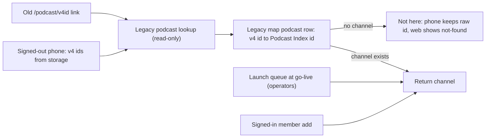

# Signed-out feed carryover: migration doc updates

Deferred. To run it, open a chat and say: "Implement
`.llm/plans/active/v4-signed-out-feed-carryover-docs.md`."

Docs only, under [docs/proposals/v4-to-v5-migration/](/docs/proposals/v4-to-v5-migration/). No
code, migrations, or release-scratchpad entry (v4-to-v5 proposal docs are exempt). Keep counts
only; no account ids, emails, or feed URLs.

## Decisions being recorded

The operator agreed to these:

- No signed-out path ever writes a feed. The lookup is read-only.
- Launch queue = subscribed public shows (about 64,000) plus public shows with v4 page views and
  no subscriber (25,041). About 89,000 parses on `rss-slow`, queued by operators before go-live.
- Lookup cap: 2,000 ids per request, plus rate limits per IP address and per install.
- Signed-out Add by RSS addresses carry over as stored addresses and refresh only with a
  membership (current v5 behavior).
- Every feed records how it entered the catalog. Account-added feeds keep a link to the account
  that disappears when the account is deleted.



## Evidence (read-only v4 snapshot, counts only)

- Subscriptions per account: max 4,314, next 1,910; p50 5, p99 132, p99.9 449; 11 accounts above
  500, 4 above 1,000.
- Eligible v4 podcasts (public, not spam or takedown, numeric Podcast Index id): 4,784,967.
- Eligible podcasts with any `stats_podcast.play_count > 0`: 32,994. Of those, 25,041 have no
  signed-in subscriber.
- `stats_podcast` is Matomo page views (`Actions.getPageUrls` in v4 `podverse-api`
  `src/services/stats.ts`). The views come from the website, and from the v4 app only when
  tracking is enabled (`podverse-rn` `src/services/tracking.ts`; iOS needs tracking permission).
  It is a partial signal for signed-out app listeners.
- v5 does not store who added a feed. `accountId` rides only in the on-demand queue message
  ([apps/api/src/controllers/mq/mq.ts](/apps/api/src/controllers/mq/mq.ts), the `mqRSSAdd` call).
  `feed` and `channel` have no source column
  ([0001_app_schema.sql](/infra/k8s/base/ops/source/database/linear-migrations/app/0001_app_schema.sql)).

## Edits by file

### [05-id-mapping-and-catalog-seeding.md](/docs/proposals/v4-to-v5-migration/05-id-mapping-and-catalog-seeding.md)

- **Launch queue** section: add the second set (public, not spam or takedown, page views in v4,
  no subscriber). Note that `stats_podcast` is used only to choose what to parse. It is not
  imported, and this does not conflict with "Do not copy v4 popularity" under Catalog seeding
  order.
- New **Legacy podcast lookup** section after Launch queue:
  - The caller sends v4 podcast ids only, never URLs. No sign-in is required. The lookup never
    queues a parse.
  - Before go-live, a worker writes one `podcast` legacy map row per eligible v4 podcast (about
    4.8 million, ids only, `resolve_key` = Podcast Index id). An id then resolves after v4 is
    shut down, and through a channel added later under the same Podcast Index id.
  - The answer is either the channel, or "not here" for an unknown id, an ineligible id, or a
    show not yet in v5. Ineligible ids get no error.
  - Limits: 2,000 ids per request, rate limits per IP address and per install. The install id is
    a random value kept on the phone and proves nothing.
- New **Feed source** section:
  - Add `feed.added_via` (for example `launch_seed`, `account_add`, `podcast_index`,
    `opml_import`), plus a `feed_add_event` table: `feed_id`, `source`, nullable `account_id` with
    `ON DELETE SET NULL`, `created_at`.
  - Use: find every feed one account added that nobody else follows, and remove them. On account
    deletion the feed stays (it is public catalog data) and the link is erased.
  - No IP addresses, hashed install ids, or pseudonymous ids. No signed-out path writes feeds.
  - When an account adds a show that has a `podcast` legacy map row, the channel takes the v4
    shortid as `id_text`, so old links and phones resolve.
- **Honest limits and risks**:
  - Launch queue size is now about 89,000.
  - Page views miss most signed-out app listeners. Their less common shows stay "not here" until
    a member adds them.
- **Future plan sets**:
  - Extend the launch-queue worker to the viewed set.
  - Worker that writes the `podcast` legacy map rows.
  - Read-only lookup API route (OpenAPI and integration tests per repo rules).
  - Feed source column and add-event table (linear migration, writers in the parser and add
    routes).

### [08-mobile-first-launch-migration.md](/docs/proposals/v4-to-v5-migration/08-mobile-first-launch-migration.md)

- Proposed approach, step 2:
  - The one-shot migrator sends the saved subscription ids to the legacy podcast lookup in one
    batch, after first paint, as a queued sync job.
  - An id that is not found is kept on the device and checked again on later syncs.
  - Add by RSS addresses are stored. They refresh only for a signed-in member, the same as other
    v5 Add by RSS feeds.
- Honest limits: a show no account subscribed to and nobody viewed in v4 shows as unavailable on
  a signed-out phone until a member adds it.

### [11-web-api-and-url-cutover.md](/docs/proposals/v4-to-v5-migration/11-web-api-and-url-cutover.md)

- Redirects section: `/podcast/:id` with no channel under that id asks the legacy podcast lookup.
  If a channel exists for the same Podcast Index id, redirect there. Otherwise show the friendly
  not-found page. A page view never queues a parse.

### [04-v4-data-inventory-and-scope.md](/docs/proposals/v4-to-v5-migration/04-v4-data-inventory-and-scope.md)

- At the `stats_*` row or note:
  - `stats_podcast` is read once to pick the launch queue's viewed set.
  - Source is Matomo page views (web, plus app with tracking enabled).
  - Still not imported.

### [06-database-migration-rehearsal.md](/docs/proposals/v4-to-v5-migration/06-database-migration-rehearsal.md)

- The launch-queue timing measurement covers both sets (about 89,000).

### [_OVERVIEW.md](/docs/proposals/v4-to-v5-migration/_OVERVIEW.md)

- Change the existing row "At go-live, queue subscribed public shows on rss-slow before
  migration" to include viewed shows.
- Add decision rows:
  - Signed-out v4 ids resolve through a read-only lookup; no signed-out feed writes
  - Lookup accepts at most 2,000 ids per request
  - Signed-out Add by RSS addresses are kept; refresh needs a membership
  - Feeds record their source; account links clear on account deletion

## Style constraints

- Plain sentences, matching the existing doc voice.
- Follow **llm-safe-plan-vocabulary**: avoid the job-seeker noun, "dead" for controls, and
  "child".
- Do not paste feed URLs or account ids.

## Checklist

- [ ] Doc 05: launch queue, Legacy podcast lookup, Feed source, risks, future plan sets
- [ ] Doc 08: migrator sends ids to the lookup; keeps ids it can't resolve; Add by RSS stays
      membership-gated; limit
- [ ] Doc 11: `/podcast/:id` without a channel uses the read-only lookup, then not-found
- [ ] Doc 04: how `stats_podcast` is used and its source
- [ ] Doc 06: launch-queue measurement covers about 89,000
- [ ] Overview: launch queue row and four decision rows

## Operator check after the edits

Root tab:

```bash
npx prettier --check docs/proposals/v4-to-v5-migration
```
