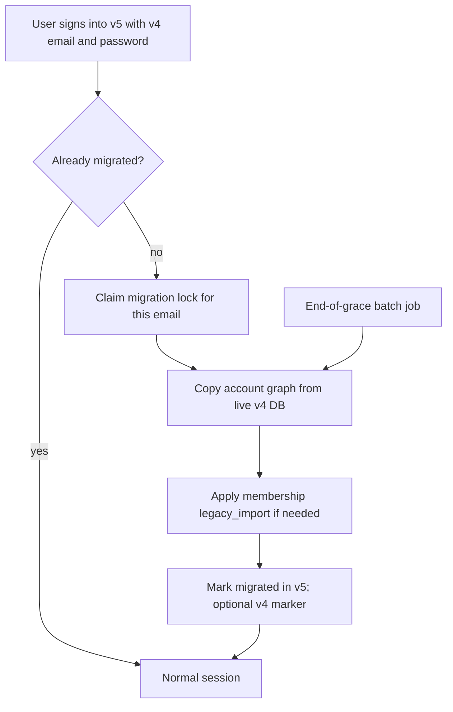

# 07 — Account and Data Migration Model

## Goal

Choose how user-owned v4 data enters v5 during the rolling upgrade: on login,
in batch, or both.

## Status

Draft. Needs operator review. **Recommended: hybrid** (lazy on first v5 login +
forced batch at grace-period end).

## What we know

- Operator intent: after v5 is live, logging into v5 with existing credentials
  starts migration immediately, with a loading screen that explains the wait.
- At grace-period end, remaining accounts are migrated without waiting for
  login, and the v4 app becomes unusable ([13](13-forced-migration-and-v4-shutdown.md)).
- Beta is a standalone database that becomes prod ([09](09-beta-environment.md)).
- Membership expiry import already assumes v5 accounts exist first
  ([BILLING-OPERATIONS](/docs/billing/BILLING-OPERATIONS.md#v4-membership-carryover)).
- Alpha (and later beta) may already have accounts with the same emails as v4
  users.

## Proposed approach: hybrid

### Lazy path (grace period)

1. Authenticate against v5. If no v5 account, verify password against the v4
   hash (imported or read live once), then create the v5 account with that hash.
2. If a v5 account already exists for that email (alpha/beta tester), verify
   ownership carefully (same password, or explicit merge rules) before attaching
   v4 graph data.
3. Copy subscriptions, add-by-RSS URLs, playlists, clips, queue, history, now
   playing, and notification prefs through the legacy map
   ([05](05-id-mapping-and-catalog-seeding.md)).
4. Show a blocking loading UI with honest time expectations from rehearsal.
5. After success, **v5 is source of truth** for that user. Further v4 writes
   for that account should not win (prefer a v4-side migrated marker if a small
   API deploy is acceptable; otherwise rely on "stop using v4" messaging).

### Forced path (grace end)

- Same copy pipeline, driven by a worker over all not-yet-migrated users.
- Then raise min mobile version and retire v4 ([13](13-forced-migration-and-v4-shutdown.md)).

### Email and conflict rules (to finalize)

- Match email case-insensitively.
- Unverified v4 emails: still migrate, but keep v5 verification policy explicit.
- Duplicate v5 accounts for one email: fail closed and page an operator report
  (counts only in automated logs).

## Honest limits and risks

- Live reads against production v4 during lazy migration add load. Rate-limit
  and cache the legacy map.
- Dual-write races: user keeps using v4 after migrating on another device.
  Without a v4 migrated marker, last-write-wins is undefined — **this is the
  strongest case for a small v4 API change**.
- Long migrations hurt mobile UX; rehearsal must set a timeout and resume story.
- Alpha data that was never in v4 must not be deleted when attaching v4 graph
  data to the same email.

## Open questions

- Implement the optional v4 `migratedAt` (or equivalent) marker?
- On email collision with different passwords, which wins?
- Migrate while calling live v4 Postgres from v5 workers, or ETL into a staging
  extract first?
- Idempotency key: v4 user id, email, or both?

## Future plan sets

- API/worker design for `migrateAccountFromV4`.
- Mobile and web loading-screen UX and failure retry.
- Conflict-report tooling for operators.
