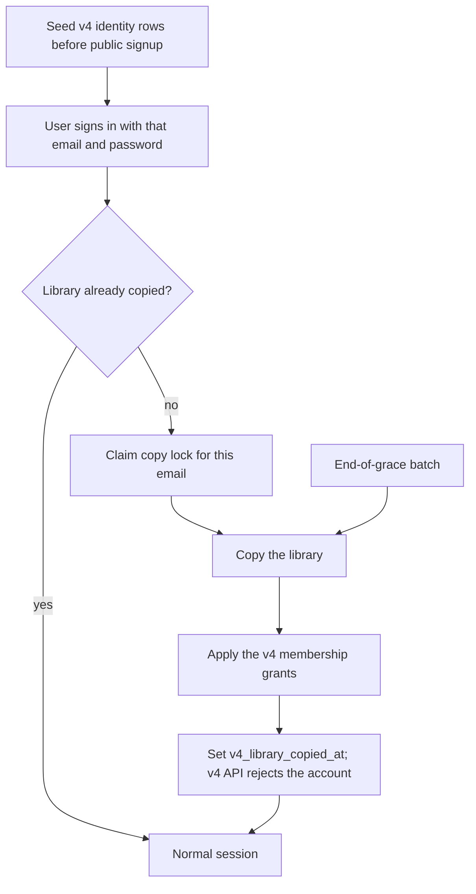

# 07 — Account and Data Migration Model

## Goal

Choose how user-owned v4 data enters v5 during the rolling upgrade: on login,
in batch, or both.

## Status

Hybrid is the model. Seed each v4 identity into v5 before public signup, copy
the library on first v5 login, then batch anyone still left at grace-period
end. A future paid v4 expiry sets Premium. A carried v4 trial stays Trial.

## What we know

- Operator intent: after v5 is live, logging into v5 with existing credentials
  starts migration immediately, with a loading screen that explains the wait.
- At grace-period end, remaining accounts are migrated without waiting for
  login, and the v4 app becomes unusable ([13](13-forced-migration-and-v4-shutdown.md)).
- After launch, beta and production share the production database
  ([09](09-beta-environment.md)).
- Membership expiry import already assumes v5 accounts exist first
  ([BILLING-OPERATIONS](/docs/billing/BILLING-OPERATIONS.md#v4-membership-carryover)).
- Alpha (and later beta) may already have accounts with the same emails as v4
  users.

## Proposed approach: hybrid

### Identity seed

Before a new person can sign up on the v5 database that will become prod, seed
one account per v4 user. v5 already keeps `account_credentials.email` unique,
so the row reserves the address. The placeholder is that account row. There is
no side table to drop. The seed copies `users.email`, the bcrypt
hash, `users.name`, `users.emailVerified`, and `users.id` as `account.id_text`.
It also writes the settings, membership status, and metaboost rows a signup
creates. A future paid `membershipExpiration` sets Premium. A
`freeTrialExpiration` that is still running and ends within 90 days becomes a
Trial grant ending on that timestamp, and the account stays Trial when the
paid expiry is not in the future. It does not copy subscriptions, playlists,
clips, queue, history, or follows, it does not start the 31-day signup trial,
and it does not write the paid grant. Running it again for the same v4 id
fills any of those rows that are missing and does not change a membership
status that already exists.

`account.v4_library_copied_at` is a nullable timestamp. Null means the identity
is reserved and the library is not copied. The copy sets it. The time is the
record that the copy finished. Once every copy has finished, a later migration
may drop this column. The account rows stay.

An email that already belongs to a different v5 account is skipped. Do not
change that account's password and do not attach the v4 library. Report the
v4 user id for an operator. When the email and the v4 id already belong to
the same seeded account, the seed fills missing rows and does not change the
password. v4's unique index on `email` is case-sensitive, so the same address
can be stored twice when one row has different letter case. The app
lowercases the address when it saves a user, which is why a later save of the
mixed-case row cannot land: it would collide with the lowercase row. v5 keeps
one lowercase address. A row that was used beats one that never was. Used
means a subscription, a followed playlist or user, an Add by RSS feed, or
dated activity in history, queue, now playing, an owned playlist, or a user
clip. Between used rows, the later dated activity wins, and a dated row beats
a row with lists only. Otherwise a verified row wins, then the later account
`updatedAt`. It logs the other v4 id. The left-out row's library is dropped,
not merged: it has no v5 account, so `v4CopyAccountLibrary` logs
`skip_missing_account` for it, and another account's follow of it stays
unresolved. A mixed-case address with no twin is
stored in lowercase. v5 stores the trimmed lowercase address, and a check
constraint refuses any other form (`0006_account_email_lowercase.sql`). The
migration rewrites an existing mixed-case address first, and stops if two rows
would become the same address. Sign-in matches the typed address after
trimming and lowercasing it. It does not move the address when that
account's library is already copied, or when the account has a grant other
than the carried trial. Counts only in automated logs. The worker command is
`v4SeedAccountIdentity` (`--v4-id`, `--dry-run`). It reads `V4_DATABASE_URL`
and writes the v5 identity rows. It does not copy a library. The library dry
run is `v4CopyAccountLibrary` (`--v4-id`, `--dry-run`). It counts each group
against rows already in v5 and writes nothing, including
`v4_library_copied_at`. The catalog command is `v4SeedAccountCatalog`
(`--v4-id`). `--dry-run` counts the public shows that account needs and which
already have a local feed. Without `--dry-run` it creates each missing local
feed, keeps the v4 podcast id as `channel.id_text`, and queues a parse. It
refuses a non-local database.

Before accounts are invited to migrate, queue the subscribed and viewed
public shows on `rss-slow`. A show already stored is left alone. Other
shows wait for the account that needs them. The rules are the launch
queue in [05](05-id-mapping-and-catalog-seeding.md#launch-queue).

The v4 API keeps serving that person until the library copy finishes. The
rejection from the earlier decision happens at copy, not at seed.

### Lazy path (grace period)

1. Sign-in finds the seeded account and checks the password against the copied
   hash. Do not use the public signup path. Signup sets Trial and inserts a
   new 31-day trial from now.
2. If `v4_library_copied_at` is already set, continue as a normal session. If
   it is null, a v5 worker copies that one library. It reads that account's
   rows from v4 at this moment, over a read-only connection. The v4 app does
   not run the job. No other accounts are copied during the grace period. A
   retried copy uses `users.id` and the email together, and it runs only while
   the timestamp is null.
3. Copy subscriptions, add-by-RSS URLs, user follows, playlists, user clips,
   queue, history, and now playing through the legacy map
   ([05](05-id-mapping-and-catalog-seeding.md)). A v5 cap that v4 did not have
   must not silently drop rows. See
   [Account caps v4 did not have](#account-caps-v4-did-not-have). An add-by-RSS URL drops a
   trailing path slash before it is stored. The host root keeps its slash. A
   public catalog feed URL is stored as given. `playlists.isDefault` becomes
   that account and medium's Likes playlist. Official chapters and soundbites
   are not clips. Purchase receipts and Django tables are not copied.
4. Apply membership from the rules below.
5. Show the copy as a list of groups, in order: subscriptions, Add by RSS,
   follows, playlists, clips, queue, history, now playing, and membership.
   A group with nothing to copy is left off the
   list. The worker records which group it is on, and how many rows of that
   group are copied once the group's total is known. The screen reads that
   record. Closing the app does not stop the worker. Opening the app again
   reads the same record and does not start a second copy. The list does not
   sit in front of the first screen. The person can use the app while the
   copy runs, and the list stays visible until `v4_library_copied_at` is set.
6. After success, v5 is the source of truth for that user. Record the copy on
   the v4 account. The v4 API then rejects that account. The legacy app and
   website may not show the reason. Support guides those people to v5. This
   needs a v4 API deploy.

### Membership on the copied account

- A v4 trial that ends within 90 days becomes a Trial grant ending on that
  timestamp, and the account stays Trial. No second signup trial. A trial
  date more than 90 days ahead is not imported. A past trial timestamp grants
  nothing.
- A future paid `membershipExpiration` is kept as stored, and the account is
  Premium. An account with an App Store purchase on 2023-12-27 through
  2024-01-31 whose expiry is more than five years ahead is imported as five
  years from the import time, still Premium.
- Receipts stay out of v5. The operator-held archive is a separate step.
- The identity seed sets Premium or Trial, and it writes the carried trial
  grant. `legacy_import` writes the paid grant and the expiry, including the
  five-year cap. It does not change the tier.

### Forced path (grace end)

- Same copy pipeline, for accounts whose `v4_library_copied_at` is still null.
  This is the only bulk pass. A v5 worker reads v4 slowly, over a read-only
  connection. The v4 app does not run it.
- Then raise min mobile version and retire v4 ([13](13-forced-migration-and-v4-shutdown.md)).

### Email and conflict rules

- Match email case-insensitively. The unique email column is what stops a new
  signup from taking a v4 address.
- The 1,990 unverified accounts are seeded with the rest. `users.emailVerified`
  is copied onto `account.verified`. Leaving them out would let a new signup
  take the address, and it would drop the 571 signup subscription lists and
  the 4 future memberships. They are not emailed
  ([10](10-user-communication.md)). A later sign-in, or the end-of-grace
  batch, can still copy the library.
- An email already in v5 is left as it is. The v4 library is not attached
  automatically.

## Account caps v4 did not have

Open. This is required before a grace-period copy or the end-of-grace batch is
treated as finished. The numbers and the override shape are not chosen here.

v4 did not cap some libraries that v5 caps. A copy that stops at the v5 default
would leave part of that library behind. Before either copy path runs for real,
list every v5 cap that can refuse a row this copy is supposed to keep, and
decide each one. Known examples:

- Add by RSS. Trial and Premium share a default of 100. A per-account
  `max_add_by_rss_feeds` override already wins over that default. On the counted
  v4 snapshot, some accounts have more than 100 addresses, including one with
  5,215.
- Directory follows. Subscriptions, playlist follows, and account follows are
  one total in the draft follow cap. That cap is not shipped. On the same
  snapshot, some accounts have more than 500 podcast subscriptions, including
  one with 4,314.

Other caps that can drop a copied row belong on the same list. Clips, queue,
history, and now playing are not on it until someone shows a cap that would
refuse them.

For each cap, the open decision is whether an account already over the v5
default keeps the whole v4 library. Where the answer is yes, the copy writes
that account's override before those rows, then copies the rows. It does not
stop at the default and call the account done. What a later add does, after the
copy, is part of the same decision.

Draft ladders in
[account-add-by-rss-cap-500.md](/.llm/plans/active/account-add-by-rss-cap-500.md)
and
[account-follow-cap-5000.md](/.llm/plans/active/account-follow-cap-5000.md)
count who is over the defaults. They are not this decision.
`v4CopyAccountLibrary` does not write an override today.

## Honest limits and risks

- Each grace-period copy is one account, and the end-of-grace batch is
  throttled. Both use a read-only v4 connection from a v5 worker. Cache the
  legacy map. The v4 app does not do this work.
- A person who already migrated can still open the legacy app. The v4 API
  rejects that account. The screen may not explain the failure. Support tells
  them to use v5.
- A long history group can take a while. The person can leave. The worker
  finishes, and the next open shows the same group and row count.
- An alpha or beta account with the same email is not overwritten. That v4
  library waits for an operator.

## Future plan sets

- Decide the per-account overrides for caps v4 did not have, then have the
  library copy write each override before the rows it covers. See
  [Account caps v4 did not have](#account-caps-v4-did-not-have).
- API/worker design for `migrateAccountFromV4`.
- Mobile and web loading-screen UX and failure retry.
- Conflict-report tooling for operators.
