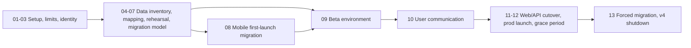

# v4 to v5 Migration Overview

High-level plan for moving Podverse from v4 (OGen / Legacy) to v5 (NextGen). These
docs are drafts for operator review. They are not runbooks and not implementation
plans. Later plan sets will be written from them.

Agents do not commit or push these docs. The overnight inventory pass is finished.
Resume with
[.cursor/prompts/v4-to-v5-migration-guided.md](/.cursor/prompts/v4-to-v5-migration-guided.md):
one chunk, then stop and ask. Leave edits in the working tree until the operator
commits them.

## Vocabulary

| Term                     | Meaning                                           |
| ------------------------ | ------------------------------------------------- |
| v4 / OGen / Legacy       | Current production: `podverse-api`, `podverse-rn` |
| v5 / NextGen             | This monorepo, including `apps/mobile`            |
| Grace period             | Time after v5 store launch while v4 still works   |
| In-place upgrade         | v5 ships under the v4 store ids                   |
| Lazy migration           | Copy a user's v4 data into v5 on first v5 login   |
| Forced / batch migration | Migrate remaining accounts at grace-period end    |

## Decisions log

| Decision                                                                 | Status  |
| ------------------------------------------------------------------------ | ------- |
| Docs live under `docs/proposals/v4-to-v5-migration/`                     | Decided |
| v5 prod ships under v4 store ids (in-place upgrade)                      | Decided |
| No new v4 mobile release                                                 | Decided |
| Prefer config-only or v5-only paths; v4 API deploys OK if needed         | Decided |
| After launch, beta and prod share the production database                | Decided |
| Beta builds cannot purchase; sandbox purchases stay on alpha             | Decided |
| Alpha is internal testing; beta is public pre-release testing            | Decided |
| No tester count; operators decide when beta is ready to submit           | Decided |
| Grace v5 API is api-prod.podverse.fm; then api.podverse.fm               | Decided |
| v5 website goes live at operator discretion, likely first store approval | Decided |
| Legacy id map lives in the app database; workers write it                | Decided |
| Unmatched ids stay unresolved until a finished parse cannot match them   | Decided |
| User clips are never dropped; see doc 05 for hidden episodes             | Decided |
| Do not import v4 stats; v5 popularity starts from its own listens        | Decided |
| Refresh the practice copy when a run starts and before the seed          | Decided |
| Library copy shows its groups and keeps running after the app closes     | Decided |
| Only operators run commands against the practice-run database copy       | Decided |
| On-device ids are saved first and matched when the network is available  | Decided |
| Signed-out phone carryover bar is subscriptions and Add by RSS           | Decided |
| First store version is the app version; Android code stays above 5280    | Decided |
| v5 reuses Firebase project podverse-app; v4 tokens stay out              | Decided |
| Next alpha, beta, and prod send with podverse-next-fcm; v4 admin stays   | Decided |
| Ask once per device if the account had a v4 podcast notification         | Decided |
| Live v4 iOS app is App Store Connect 1390888454, not 6823398032          | Decided |
| Apple Team ID DF9KG8H54B signs the live v4 app and Podverse Next         | Decided |
| Play App Signing is on for com.podverse; Google signs the releases       | Decided |
| Production v4 is believed to run master; entity code matches develop     | Decided |
| Extra v4 worktrees wait until someone starts the migration code          | Decided |
| Episode playlist rows point at the episode and do not invent a clip      | Decided |
| Playlist members come from the joins; `itemsOrder` only sorts            | Decided |
| A follow uses the survivor when an absorb merge is already applied       | Decided |
| The selective seed skips spam, takedown, and non-public podcasts         | Decided |
| At go-live, queue subscribed and viewed public shows on rss-slow         | Decided |
| Signed-out v4 ids use a read-only lookup; signed-out never adds feeds    | Decided |
| The legacy podcast lookup accepts at most 2,000 ids per request          | Decided |
| Signed-out Add by RSS addresses are kept; refresh needs a membership     | Decided |
| Feeds record their source; the account link clears on account deletion   | Decided |
| Copied list order uses the ORM step of `0.00000001`                      | Decided |
| Phone-storage spike is written in doc 08 and has not been run            | Decided |
| F-Droid is a placeholder until later                                     | Decided |
| Do not import `subscribedPodcastListIds`                                 | Decided |
| App Store rows from 2023-12-27 through 2024-01-31 are not real purchases | Decided |
| Official chapters and soundbites stay out of `clip`                      | Decided |
| v4 public web URLs keep working; changed paths stay reserved redirects   | Decided |
| Carry over `subscribedUserIds` into `account_following_account`          | Decided |
| Migrated public entities keep their v4 shortid as `id_text`              | Decided |
| `nano_id_v2` accepts 7–15 characters; new ids stay 10 characters         | Decided |
| Leave v4 `accountClaimToken` rows behind                                 | Decided |
| Carry v4 trials that end within 90 days as Trial grants                  | Decided |
| Keep paid `membershipExpiration` values with no 90-day cap               | Decided |
| Cap App Store window memberships longer than 5 years to 5 years          | Decided |
| Do not import v4 purchase receipts; archive them outside git             | Decided |
| v4 default playlists become that account's v5 Likes playlist             | Decided |
| Do not import Django `auth_*` or `django_*` tables                       | Decided |
| Hybrid account migration: first v5 login, then end-of-grace batch        | Decided |
| Paid v4 expiry becomes Premium; a carried trial stays Trial              | Decided |
| Once v5 is live in one place, turn off v4 Apple, Google, and PayPal      | Decided |
| v4 API rejects an account after that account has been copied to v5       | Decided |
| Seed v4 identities before public signup; copy the library later          | Decided |
| Placeholder is the v5 account row; no side table to drop                 | Decided |
| During grace, copy one library at sign-in; bulk copy waits for the end   | Decided |
| An existing v5 email is not overwritten; that library waits              | Decided |
| Grace period is 30 days once v5 is installable, and the end can move     | Decided |
| Public date is earlier than the real end and tells people to update      | Decided |
| Announcement says NextGen, asks for a backup, and says we keep one too   | Decided |
| Announcement email goes only to verified v4 accounts                     | Decided |
| Unverified v4 accounts are seeded and are not emailed                    | Decided |
| Announcement is from contact@podverse.fm; the send method comes later    | Decided |
| Announcement email stays English; v4 stores no user locale               | Decided |
| Operator reviews copied, remaining, and failed accounts once a day       | Decided |
| Open the rest of the store rollout after a calm day of sign-in copies    | Decided |
| After migration, block public v4 API requests; the process may stay up   | Decided |
| Private v4 process stops once the final database archive is checked      | Decided |
| Keep the v4 archive after the grace window; retention length comes later | Decided |
| Minimum version number waits for the first live store build              | Decided |
| NextGen still needs an app-wide minimum-version check before go-live     | Decided |
| NextGen version check is a public semver compare after first paint       | Decided |
| Purchase floor stays on checkout options; drop the after-charge 426      | Decided |
| NextGen sign-in uses the copied password; no v4 session exchange         | Decided |
| No public migration page; a longer reply goes out when people ask        | Decided |
| Installed app cannot show custom text or open a browser from a push      | Decided |
| No mass notification; the announcement email is the public message       | Decided |
| Beta hosts: beta, api-beta, management.beta, management-api.beta         | Decided |
| Beta cookies stay on each API host, not on .podverse.fm                  | Decided |

## Sequence

## Step summaries

| Doc                                            | Summary                                                   |
| ---------------------------------------------- | --------------------------------------------------------- |
| [01](01-legacy-repos-and-reference-setup.md)   | Where v4 code lives, worktrees, and the prod-copy test DB |
| [02](02-capabilities-and-limits.md)            | What can and cannot be done without a v4 app release      |
| [03](03-store-identity-and-signing.md)         | Ship v5 under `com.podverse.fm` / `com.podverse`          |
| [04](04-v4-data-inventory-and-scope.md)        | Per-table migrate / map / drop decisions                  |
| [05](05-id-mapping-and-catalog-seeding.md)     | Map v4 shortids to v5 feeds and channels                  |
| [06](06-database-migration-rehearsal.md)       | Near-term: measure and dry-run against the prod copy      |
| [07](07-account-and-data-migration-model.md)   | Lazy login migration plus end-of-grace batch              |
| [08](08-mobile-first-launch-migration.md)      | Best-effort local storage and download carryover          |
| [09](09-beta-environment.md)                   | Beta and prod share the production database               |
| [10](10-user-communication.md)                 | Email, store listing, and min-version overlay             |
| [11](11-web-api-and-url-cutover.md)            | Web host, API host, and URL redirects                     |
| [12](12-production-launch-and-grace-period.md) | Store rollout and the rolling upgrade window              |
| [13](13-forced-migration-and-v4-shutdown.md)   | Batch remaining users and retire v4                       |
| [14](14-fdroid.md)                             | F-Droid placeholder                                       |
| [15](15-near-term-rehearsal-checklist.md)      | Ordered rehearsal steps before migration code             |

## Can and cannot (honest summary)

### Can

- Keep every public v4 web URL working on `podverse.fm`. Migrated pages keep
  the v4 shortid. When the path changes, reserve the old URL and redirect it.
  See [11](11-web-api-and-url-cutover.md).
- Keep the current v4 app binary on the stores during the grace period.
- Block old clients later by raising `MINIMUM_MOBILE_VERSION` (env only).
- Import v4 bcrypt password hashes into v5 (same algorithm and rounds).
- Read signed-out AsyncStorage and downloads only if v5 uses the v4 store ids.
- During the grace period, copy one v4 library when that person signs into v5.
  A v5 worker reads those rows at that moment. The bulk copy waits for grace
  end. The v4 app does not run either job.
- Leave v4 popularity behind. v5 totals start empty and fill from v5 listens.
- After launch, run beta clients against the production database so tester
  data and production data are the same rows.

### Cannot (or cannot without trade-offs)

- Show free-text in-app announcements from the v4 API without a v4 app release.
  The min-version overlay copy is hardcoded English. A notification tap opens
  the app, not a browser. Use email and the store listing for the message.
  A longer reply goes out only when someone contacts us.
- Carry over signed-out device data if v5 ships under a different bundle id.
- Promise every clip, history row, or download survives. Feeds, guids, and
  storage paths may have drifted.
- Seed popularity from Matomo or from the v4 stats tables. v5 popularity
  starts empty.
- Guess store-approval dates. The grace period starts when the stores approve
  the v5 build, not when we submit it.
- Treat F-Droid like Play. F-Droid builds and signs from source; plan later.

## Parallel tracks (can start early)

1. **Database rehearsal** ([06](06-database-migration-rehearsal.md)) against the
   prod-copy test DB. No store or beta dependency.
2. **Mobile local-data spike** ([08](08-mobile-first-launch-migration.md)) on a
   build that temporarily uses the v4 store ids in a private channel.
3. **Store identity and signing inventory** ([03](03-store-identity-and-signing.md)).
4. **Legacy-id map design** ([05](05-id-mapping-and-catalog-seeding.md)).

## Related existing material

- [v4 membership carryover](/docs/billing/BILLING-OPERATIONS.md#v4-membership-carryover)
  and the parked plan
  [`.llm/plans/active/v4-membership-expiry-import/`](/.llm/plans/active/v4-membership-expiry-import/)
- [Mobile deep links and prod cutover](/.cursor/rules/mobile-deep-links-and-prod-cutover.mdc)
- [Legacy app reference](/.cursor/rules/legacy-app-reference.mdc)
- [Mobile release runbook](/docs/operations/mobile/MOBILE-RELEASE-RUNBOOK.md)
