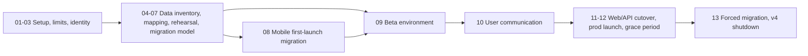

# v4 to v5 Migration Overview

High-level plan for moving Podverse from v4 (OGen / Legacy) to v5 (NextGen). These
docs are drafts for operator review. They are not runbooks and not implementation
plans. Later plan sets will be written from them.

Agents do not commit or push these docs. The overnight inventory pass is finished.
Resume with
[.cursor/prompts/v4-to-v5-migration-guided.md](/.cursor/prompts/v4-to-v5-migration-guided.md):
one chunk, then stop and ask. Leave edits in the working tree until the operator
commits them.

## Vocabulary

| Term                     | Meaning                                           |
| ------------------------ | ------------------------------------------------- |
| v4 / OGen / Legacy       | Current production: `podverse-api`, `podverse-rn` |
| v5 / NextGen             | This monorepo, including `apps/mobile`            |
| Grace period             | Time after v5 store launch while v4 still works   |
| In-place upgrade         | v5 ships under the v4 store ids                   |
| Lazy migration           | Copy a user's v4 data into v5 on first v5 login   |
| Forced / batch migration | Migrate remaining accounts at grace-period end    |

## Decisions log

| Decision                                                                 | Status  |
| ------------------------------------------------------------------------ | ------- |
| Docs live under `docs/proposals/v4-to-v5-migration/`                     | Decided |
| v5 prod ships under v4 store ids (in-place upgrade)                      | Decided |
| No new v4 mobile release                                                 | Decided |
| Prefer config-only or v5-only paths; v4 API deploys OK if needed         | Decided |
| Beta is a standalone DB that is later promoted to prod                   | Decided |
| F-Droid is a placeholder until later                                     | Decided |
| Do not import `subscribedPodcastListIds`                                 | Decided |
| App Store rows from 2023-12-27 through 2024-01-31 are not real purchases | Decided |
| Official chapters and soundbites stay out of `clip`                      | Decided |
| v4 public web URLs keep working; changed paths stay reserved redirects   | Decided |
| Carry over `subscribedUserIds` into `account_following_account`          | Decided |
| Migrated public entities keep their v4 shortid as `id_text`              | Decided |
| `nano_id_v2` accepts 7–15 characters; new ids stay 10 characters         | Decided |
| Leave v4 `accountClaimToken` rows behind                                 | Decided |
| Carry v4 trials that end within 90 days as Trial grants                  | Decided |
| Keep paid `membershipExpiration` values with no 90-day cap               | Decided |
| Cap App Store window memberships longer than 5 years to 5 years          | Decided |
| Do not import v4 purchase receipts; archive them outside git             | Decided |
| v4 default playlists become that account's v5 Likes playlist             | Decided |
| Do not import Django `auth_*` or `django_*` tables                       | Decided |
| Grace-period length                                                      | Open    |
| Whether to mark accounts as migrated in the v4 DB                        | Open    |
| Mass-email provider and list source                                      | Open    |

## Sequence

## Step summaries

| Doc                                            | Summary                                                   |
| ---------------------------------------------- | --------------------------------------------------------- |
| [01](01-legacy-repos-and-reference-setup.md)   | Where v4 code lives, worktrees, and the prod-copy test DB |
| [02](02-capabilities-and-limits.md)            | What can and cannot be done without a v4 app release      |
| [03](03-store-identity-and-signing.md)         | Ship v5 under `com.podverse.fm` / `com.podverse`          |
| [04](04-v4-data-inventory-and-scope.md)        | Per-table migrate / map / drop decisions                  |
| [05](05-id-mapping-and-catalog-seeding.md)     | Map v4 shortids to v5 feeds and channels                  |
| [06](06-database-migration-rehearsal.md)       | Near-term: measure and dry-run against the prod copy      |
| [07](07-account-and-data-migration-model.md)   | Lazy login migration plus end-of-grace batch              |
| [08](08-mobile-first-launch-migration.md)      | Best-effort local storage and download carryover          |
| [09](09-beta-environment.md)                   | Standalone beta that becomes prod                         |
| [10](10-user-communication.md)                 | Email, push, store listing, and min-version overlay       |
| [11](11-web-api-and-url-cutover.md)            | Web host, API host, and URL redirects                     |
| [12](12-production-launch-and-grace-period.md) | Store rollout and the rolling upgrade window              |
| [13](13-forced-migration-and-v4-shutdown.md)   | Batch remaining users and retire v4                       |
| [14](14-fdroid.md)                             | F-Droid placeholder                                       |

## Can and cannot (honest summary)

### Can

- Keep every public v4 web URL working on `podverse.fm`. Migrated pages keep
  the v4 shortid. When the path changes, reserve the old URL and redirect it.
  See [11](11-web-api-and-url-cutover.md).
- Keep the current v4 app binary on the stores during the grace period.
- Block old clients later by raising `MINIMUM_MOBILE_VERSION` (env only).
- Import v4 bcrypt password hashes into v5 (same algorithm and rounds).
- Read signed-out AsyncStorage and downloads only if v5 uses the v4 store ids.
- Migrate logged-in account data from the live v4 DB when the user signs into v5.
- Seed popularity from v4 `stats_*` tables (already filled from Matomo).
- Run a beta that is promoted to prod so early testers keep their data.

### Cannot (or cannot without trade-offs)

- Show free-text in-app announcements from the v4 API without a v4 app release.
  The min-version overlay copy is hardcoded English. Use email, push, web, and
  store listing for the message.
- Carry over signed-out device data if v5 ships under a different bundle id.
- Promise every clip, history row, or download survives. Feeds, guids, and
  storage paths may have drifted.
- Query Matomo live as the primary seed. Prefer the already-derived v4 stats
  tables.
- Guess store-approval dates. The grace period starts when the stores approve
  the v5 build, not when we submit it.
- Treat F-Droid like Play. F-Droid builds and signs from source; plan later.

## Parallel tracks (can start early)

1. **Database rehearsal** ([06](06-database-migration-rehearsal.md)) against the
   prod-copy test DB. No store or beta dependency.
2. **Mobile local-data spike** ([08](08-mobile-first-launch-migration.md)) on a
   build that temporarily uses the v4 store ids in a private channel.
3. **Store identity and signing inventory** ([03](03-store-identity-and-signing.md)).
4. **Legacy-id map design** ([05](05-id-mapping-and-catalog-seeding.md)).

## Related existing material

- [v4 membership carryover](/docs/billing/BILLING-OPERATIONS.md#v4-membership-carryover)
  and the parked plan
  [`.llm/plans/active/v4-membership-expiry-import/`](/.llm/plans/active/v4-membership-expiry-import/)
- [Mobile deep links and prod cutover](/.cursor/rules/mobile-deep-links-and-prod-cutover.mdc)
- [Legacy app reference](/.cursor/rules/legacy-app-reference.mdc)
- [Mobile release runbook](/docs/operations/mobile/MOBILE-RELEASE-RUNBOOK.md)
